# AccuraERP – Django Web Accounting System


---

## 🎯 Project Overview
AccuraERP is a **Django‑based double‑entry accounting system** that provides full CRUD for accounts, journal entries, ledgers, and financial reports (income statement, balance sheet, trial balance). It ships with a modern Bootstrap 5 UI, multiple colour themes, and keyboard shortcuts for fast data entry.

## 📦 Key Features (as implemented)
- **Dynamic Themes** – Light, Dark, Green, Blue, Purple (theme switcher).
- **Auto‑Balance** – `Alt + B` automatically computes debit/credit differences.
- **Financial Reports** – Real‑time Income Statement, Balance Sheet, Trial Balance.
- **General Ledger & Chart of Accounts** – drill‑down view per account.
- **Responsive UI** – works on desktop, tablet and mobile.
- **Secure Authentication** – login/registration with Django’s auth system.
- **Keyboard‑friendly** – shortcuts for posting, new line, etc.

## 🛠️ Technology Stack
| Component | Version |
|-----------|---------|
| Python    | 3.10+   |
| Django    | 5.2.8   |
| Database  | MySQL (or MariaDB) – configurable via `DATABASES` in `settings.py` |
| Front‑end | Bootstrap 5, Font‑Awesome |
| Environment | python‑dotenv (optional for local development) |

## 📁 Repository Structure
```
AccuraERP/
├── AccountingProject/          # Django project settings
│   ├── __init__.py
│   ├── asgi.py
│   ├── settings.py
│   ├── urls.py
│   └── wsgi.py
├── accounting/                # Core app
│   ├── migrations/
│   ├── templatetags/
│   ├── templates/            # HTML templates
│   ├── admin.py
│   ├── apps.py
│   ├── models.py
│   ├── views.py
│   └── forms.py
├── media/                     # Uploaded media (company logos)
├── screenshots/               # Demo images shown in this README
├── .gitignore
├── .env.example               # Example environment file
├── manage.py
├── requirements.txt
└── README.md
```

## 🚀 Installation & Local Setup
1. **Clone the repository**
   ```bash
   git clone https://github.com/24-adrita/Web-Based-Accounting-Software.git
   cd Web-Based-Accounting-Software
   ```
2. **Create a virtual environment & install dependencies**
   ```bash
   python -m venv venv
   .\venv\Scripts\activate   # on Windows
   pip install -r requirements.txt
   ```
3. **Configure environment variables**
   - Copy the example file:
     ```bash
     cp .env.example .env
     ```
   - Edit `.env` and set at least:
     ```env
     DJANGO_SECRET_KEY=your‑random‑secret‑key
     DJANGO_DEBUG=False   # Set to True for local development only
     DJANGO_ALLOWED_HOSTS=localhost,127.0.0.1
     DATABASE_NAME=your_db_name
     DATABASE_USER=your_db_user
     DATABASE_PASSWORD=your_db_password
     DATABASE_HOST=127.0.0.1
     DATABASE_PORT=3307
     ```
4. **Apply migrations & create a superuser**
   ```bash
   python manage.py migrate
   python manage.py createsuperuser
   ```
5. **Run the development server**
   ```bash
   python manage.py runserver
   ```
   Visit `http://127.0.0.1:8000/`.

## 🗄️ Database Configuration
The default configuration uses MySQL (see `settings.py`). You can switch to SQLite for quick testing by adjusting the `DATABASES` dictionary or by providing a `DATABASE_URL` environment variable.

## 📦 Production Deployment (Vercel)
### Prerequisites
- A **Vercel** account (you provided the dashboard link).
- A **MySQL** (or compatible) database instance that is reachable from Vercel. Vercel does not host persistent relational databases, so you will need an external service (e.g., PlanetScale, Railway, Render, ClearDB, or your own cloud VM).
### Steps
1. **Connect the GitHub repo**
   - In Vercel Dashboard click **"New Project"** → **Import Git Repository** → select `24-adrita/Web-Based-Accounting-Software`.
2. **Project Settings**
   - **Root Directory**: leave default (repository root).
   - **Build Command**: `pip install -r requirements.txt && python manage.py collectstatic --noinput`
   - **Output Directory**: (Vercel serves the Django WSGI app, no static folder needed).
   - **Python Runtime**: Choose the latest supported (e.g., `Python 3.11`).
3. **Environment Variables** (add the same variables from your `.env.example`). Ensure `DJANGO_DEBUG=False` and set a strong `DJANGO_SECRET_KEY`.
4. **Database**
   - Provide the connection details of the external MySQL service via environment variables.
   - Vercel will expose these variables to the running container.
5. **Static Files**
   - Django’s `collectstatic` will place static assets in the `staticfiles` directory. Vercel will serve them automatically.
6. **Deploy**
   - Click **Deploy**. Vercel will install dependencies, run migrations (you may need to trigger them manually via a one‑off “Run Command” in the dashboard: `python manage.py migrate`).
   - After a successful build, Vercel provides a public URL such as `https://your‑project.vercel.app`.

## 🔧 Post‑Deployment Checklist
- Verify that the site loads at the Vercel URL.
- Test login/registration and basic accounting flows.
- Ensure static assets (CSS/JS/images) render correctly.
- Confirm that the database is persisting data across restarts.

## Application Screenshots

### Dashboard
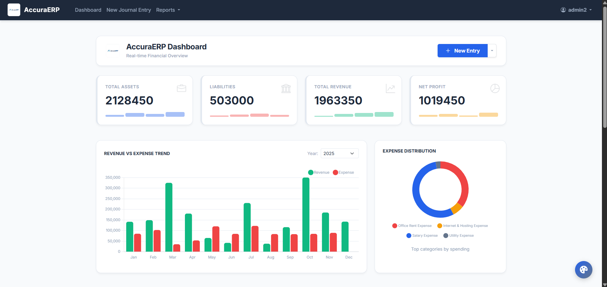
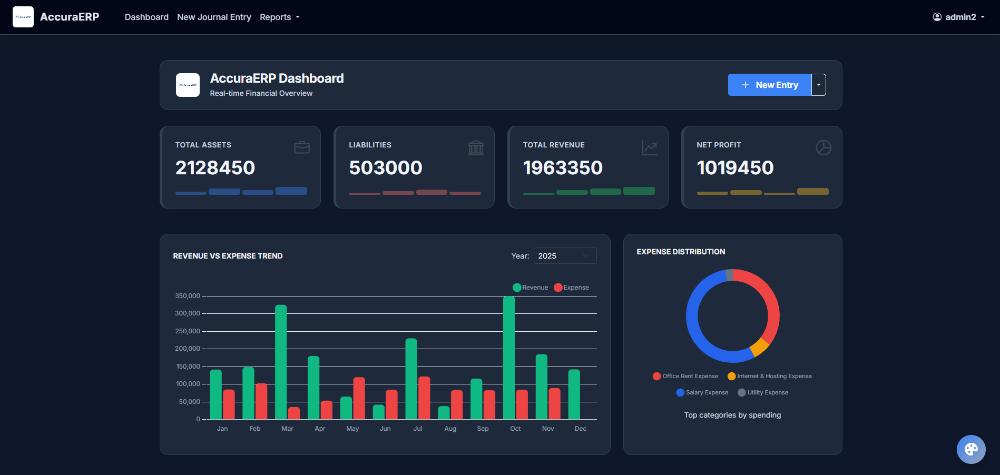
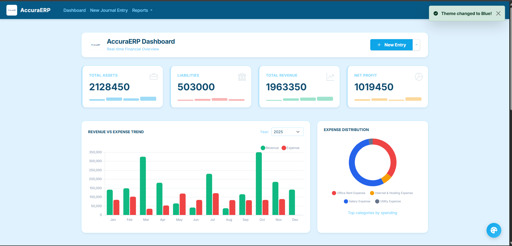
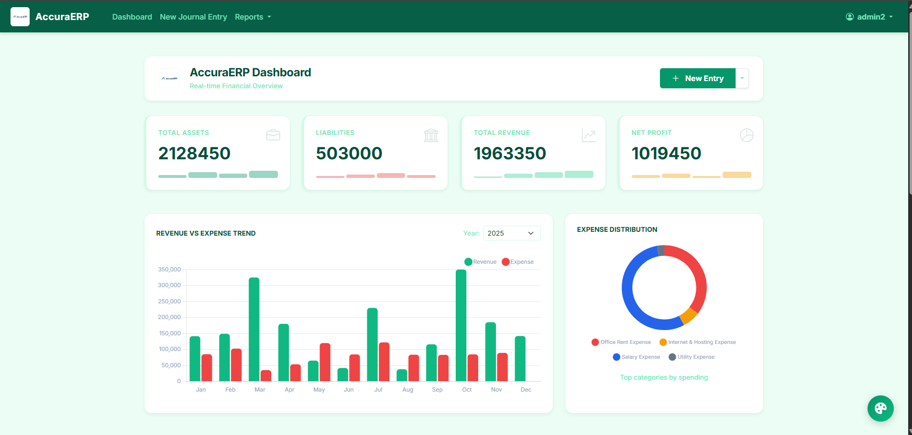
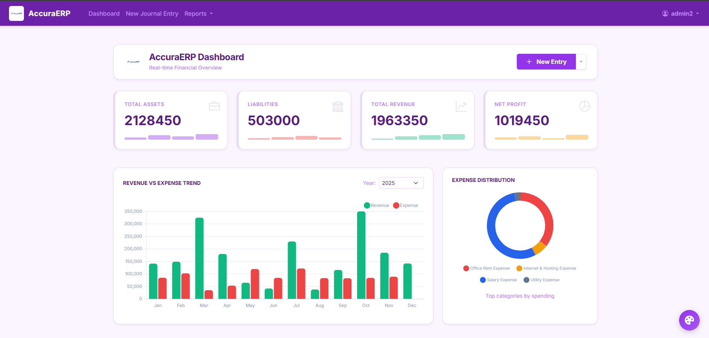

### Authentication
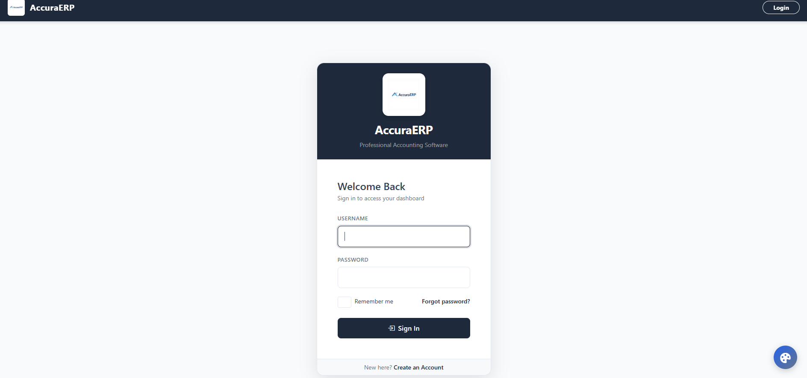
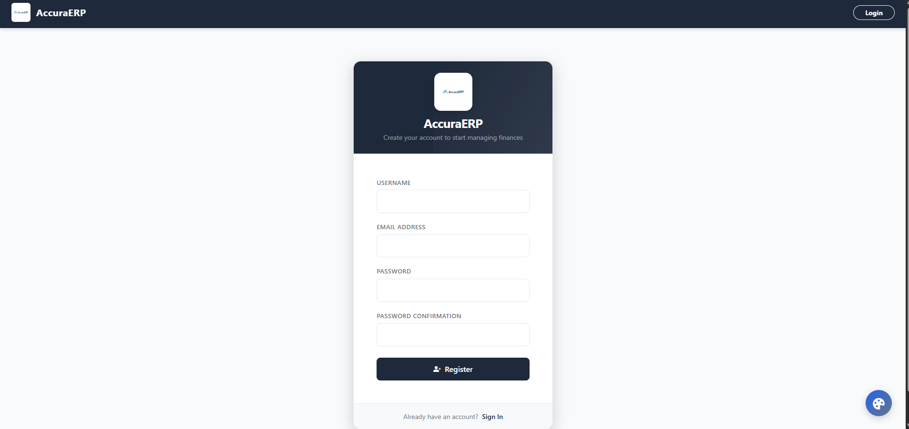

### Accounting Modules
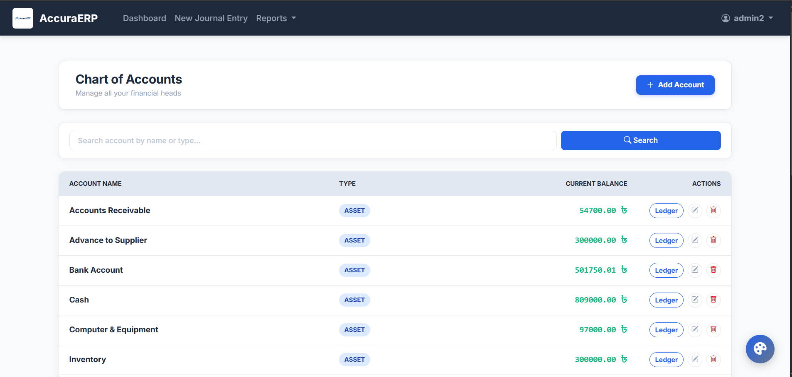
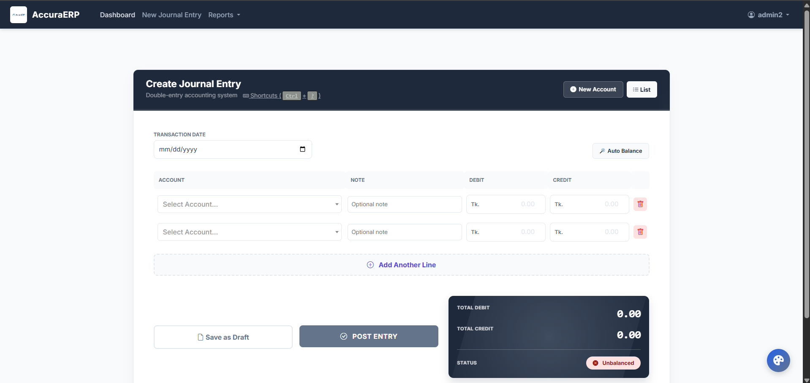
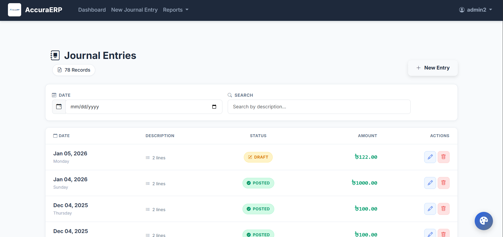
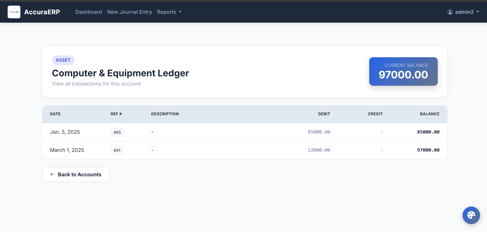
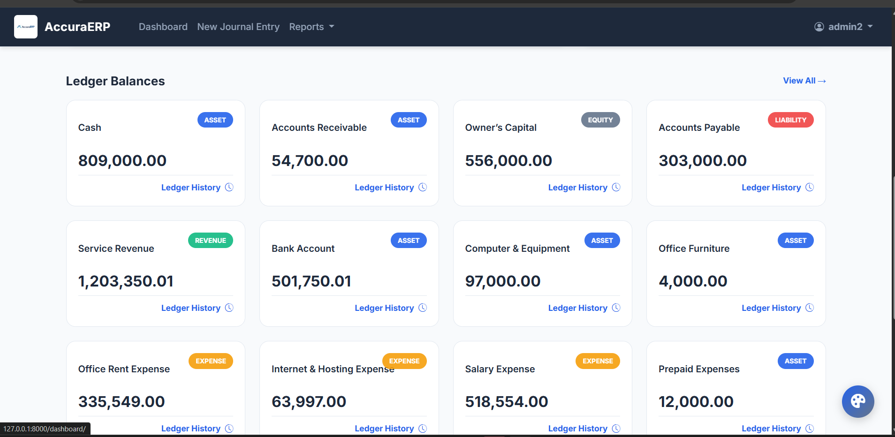

### Financial Reports
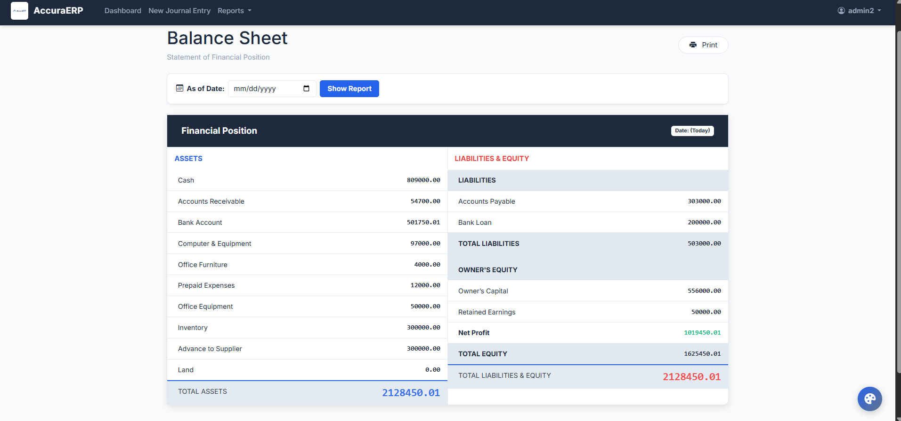
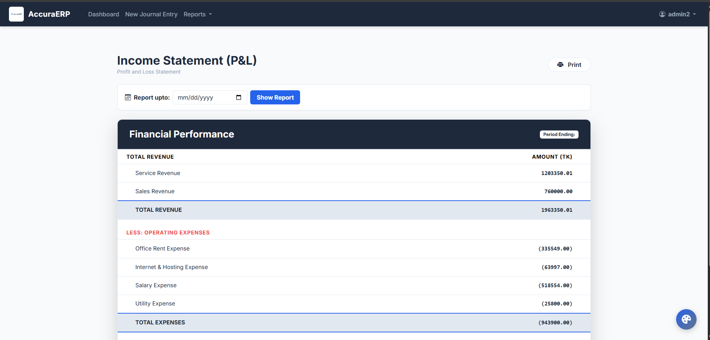
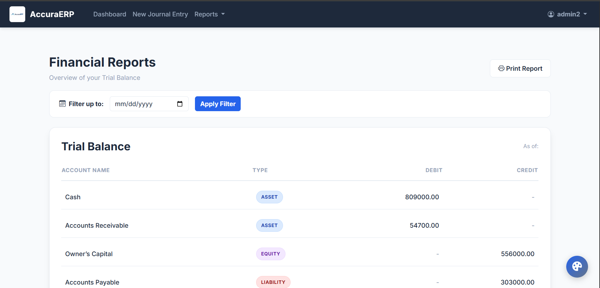

## 📈 Future Improvements (not yet implemented)
- **Dockerisation** – container image for easier local/CI deployment.
- **Unit & Integration Tests** – increase coverage.
- **API Layer** – expose REST/GraphQL endpoints.
- **Docker Compose** – for local MySQL service.
- **Enhanced Permissions** – role‑based access control.
- **CI/CD Pipeline** – GitHub Actions for linting, testing, and automatic Vercel deploys.

## 👤 Author
**Adrita Chakraborty** – [GitHub Profile](https://github.com/24-adrita)

---

*This project is provided for educational purposes. Please review the license and attribution requirements before using it in production.*
